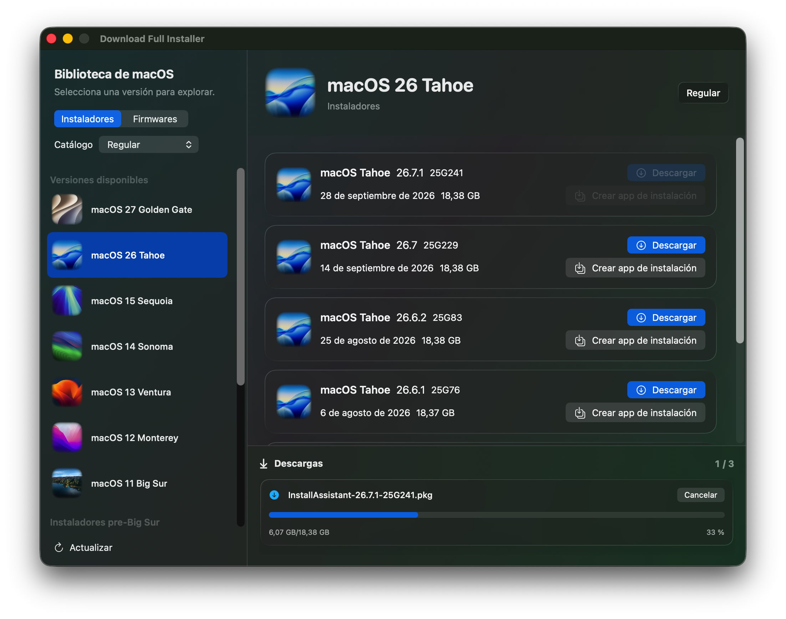

# Download Full Installer

**Download Full Installer** es una aplicación para macOS escrita en SwiftUI que descarga instaladores PKG o firmwares IPSW para la aplicación **Instalar macOS Big Sur** y versiones posteriores. Funciona en macOS 15 Sequoia y siguientes.

**Versiones**:

- Si prefieres la versión creada con Swift 5, compatible con macOS 13 o posterior, obtén el código fuente de la rama `swift5` o la versión 4.x.x desde la [página de versiones](https://github.com/perez987/DownloadFullInstaller/releases/tag/4.6.0).
- Existe una versión 2.5.5, creada con Swift 5 y compatible con macOS Big Sur o posterior. Puedes obtener el código fuente o la aplicación notarizada desde la [página de versiones](https://github.com/perez987/DownloadFullInstaller/releases/tag/2.5.5).

### Novedades de la versión 6.0.0

La ventana principal ahora es una ventana amplia de dos paneles, con degradados suaves y superficies translúcidas. Elige Instaladores o Firmwares y un catálogo de actualización de software a la izquierda; después, selecciona una versión de macOS para ver a la derecha las versiones disponibles, números de compilación, fechas, tamaños y opciones de descarga. El panel de detalles permanece vacío hasta que selecciones una versión.

Los instaladores antiguos están en una sección al final de la lista de instaladores, contraída de forma predeterminada. Usa la flecha de su encabezado para expandirla o contraerla. Todas las descargas comparten la cola de la parte inferior derecha, con hasta tres transferencias simultáneas, botones Cancelar individuales y opciones para mostrar los archivos en Finder. Cambiar la versión o el tipo de contenido seleccionado no oculta ni interrumpe las descargas. El firmware procede de una fuente independiente, por lo que el selector de catálogos está desactivado en el modo de firmware.

### Prefacio

En junio de 2025, [DownloadFullInstaller](https://github.com/scriptingosx/DownloadFullInstaller) interrumpió su desarrollo. Durante más de tres años, mi repositorio fue una bifurcación del original. Sin embargo, después de que el repositorio original se archivara, creé un nuevo repositorio independiente (<em>no bifurcado</em>).

Este repositorio existe para mantener vivo y en crecimiento «Download Full Installer». Continúa donde lo dejó el original, integra las contribuciones de la comunidad y añade nuevas funciones. Mantendré este proyecto activo y actualizado mientras siga siendo útil para otros usuarios. Todo el mérito de la idea y la arquitectura originales corresponde a <em>scriptingosx</em>.

### Funciones

- Destino y requisitos
   - macOS 15 Sequoia como mínimo (hasta macOS Golden Gate)
   - Swift 6
   - Xcode 26
- Interfaz principal
   - Lista persistente de versiones y panel de detalles para instaladores y firmwares IPSW de Apple Silicon
   - Degradados suaves, tarjetas translúcidas y ventanas de Ajustes e Idioma con diseño coherente
- Preferencias
   - Las opciones para elegir el catálogo no están en un cuadro de diálogo independiente, sino en la parte superior de la ventana principal
   - Se muestran todas las versiones disponibles; selecciona una para ver todas sus descargas
- Reposo del sistema
   - Se añade lógica para evitar que el sistema entre en reposo mientras la aplicación está en ejecución
- Descargas
   - Se añade la posibilidad de reanudar descargas, gestionando automáticamente las interrupciones de red
   - Se añade una barra de progreso superpuesta al icono de la aplicación en el Dock durante las descargas
   - Se admite un máximo de 3 descargas simultáneas
   - Se puede elegir una carpeta de descargas personalizada
   - Se limpian las descargas incompletas al cerrar la aplicación
- Idiomas
  - Se añade un sistema para seleccionar el idioma
  - Se actualizan las traducciones
- Versiones antiguas de macOS
  - Se añade compatibilidad con instaladores antiguos de macOS (10.7-10.12); consulta [este documento](DOCS/Legacy-macos.md)
- Actualizador
  - Se añade el sistema de actualización Sparkle (Swift Package Manager) para comprobar si hay nuevas versiones
- Seguridad
   - La aplicación está aislada en un entorno seguro (_sandbox_)
   - Apple ha notarizado la aplicación.

### Descarga de instaladores antiguos de macOS

Expande la sección de instaladores antiguos de macOS con la flecha de su encabezado para mostrar las cinco versiones antiguas disponibles debajo de las versiones actuales en la lista de instaladores de la izquierda. Selecciona una para descargar su imagen de disco mediante la cola de descargas compartida. Abre la DMG descargado en Finder y ejecuta su paquete para crear la aplicación instaladora. Las descargas antiguas son independientes del catálogo de actualización de software seleccionado.

### Función para crear la aplicación instaladora

Después de descargar un archivo `InstallAssistant.pkg`, puedes crear la aplicación instaladora de macOS (por ejemplo, «Instalar macOS Sequoia.app») directamente desde Download Full Installer:

1. Descarga el PKG con el botón de descarga
2. Haz clic en el botón «Crear aplicación instaladora», junto al botón de descarga
3. El archivo PKG se abrirá con el instalador estándar de macOS
4. Sigue las instrucciones en pantalla para completar la instalación
5. La aplicación instaladora de macOS se creará en la carpeta `/Applications`.

### Ajustes para seleccionar la carpeta de descargas

Download Full Installer -> menú Ajustes (⌘ ,) abre una ventana donde puedes seleccionar otra carpeta para descargar los paquetes. La carpeta predeterminada es `~/Downloads`. Los indicadores visuales (marcas verdes) de los instaladores descargados se actualizan para reflejar los archivos de la carpeta seleccionada.

### Ventana para seleccionar el idioma

Puedes abrir el selector de idioma desde la barra de menús (`Languages` > `Select Language`) o con el atajo de teclado (`⌘ + L`).

### Limpieza de descargas incompletas al cerrar la aplicación

Las descargas incompletas pueden acumularse en el directorio temporal de la aplicación _sandboxed_ 
`~/Library/Containers/perez987.DownloadFullInstaller/Data/tmp` 
y consumir espacio en disco indefinidamente. La limpieza elimina de forma segura los archivos normales (no los directorios) de `NSTemporaryDirectory()`, que corresponde a la ruta temporal de la aplicación _sandboxed_. Si no se puede eliminar un archivo concreto, la limpieza continúa con los demás.

<!--### La aplicación está dañada y no se puede abrir

Si ves este mensaje al abrir Download Full Installer por primera vez:
 `La aplicación está dañada y no se puede abrir.` 
O este otro:
 `No se pudo verificar que Download Full Installer no contenga software malicioso.` 
En ambos casos se recomienda mover el archivo a la Papelera. Consulta [este documento](DOCS/App-damaged.md). -->

# README del repositorio original
(por *scriptingosx*)

### Prefacio

Esta es una implementación en SwiftUI del script [fetch-installer-pkg](https://github.com/scriptingosx/fetch-installer-pkg) de *scriptingosx*. Muestra los paquetes instaladores completos de macOS Big Sur y posteriores disponibles para descargar en los catálogos de actualización de software de Apple. Después puedes elegir uno para descargarlo.

### Motivación

Es posible que quieras descargar el paquete instalador en lugar de la aplicación instaladora directamente, por ejemplo, si quieres volver a distribuirla con un sistema de gestión como Jamf.

Como la aplicación instaladora de macOS Big Sur contiene un único archivo de más de 8 GB, las herramientas de empaquetado normales no funcionan. He descrito el problema y algunas soluciones en detalle en [esta entrada del blog](https://scriptingosx.com/2020/11/deploying-the-big-sur-installer-application/).

### Extras

- Copiar la URL de descarga de un paquete instalador desde el menú contextual.
- Cambiar el programa de versiones preliminares desde el menú desplegable de Preferencias.
- Crear la aplicación instaladora directamente desde el PKG descargado, sin salir de la aplicación.

### Preguntas

#### ¿Puede descargar versiones antiguas de la aplicación instaladora de macOS?

No. Apple solo proporciona paquetes instaladores para Big Sur y versiones posteriores. Las versiones anteriores del instalador de Big Sur se eliminan periódicamente.

#### ¿Actualizarás esto para que pueda descargar versiones más antiguas?

No.

#### ¿En qué se diferencia de otras herramientas de línea de comandos?

Hasta donde sé, descarga el mismo paquete que `softwareupdate --fetch-full-installer` e `installinstallmacOS.py`.

La diferencia es que las otras herramientas realizan la instalación inmediatamente y dejan la aplicación instaladora en la carpeta `/Applications`. Esta herramienta solo descarga el paquete, para que puedas utilizarlo con tu sistema de gestión, archivarlo o ejecutar la instalación manualmente.

### Créditos

- Tanto [fetch-installer-pkg](https://github.com/scriptingosx/fetch-installer-pkg) como esta aplicación se basan en el script [installinstallmacos.py](https://github.com/munki/macadmin-scripts/blob/main/installinstallmacos.py) de Greg Neagle.
- Gracias a [matxpa](https://github.com/matxpa) por las correcciones y mejoras de la versión 2.0.
