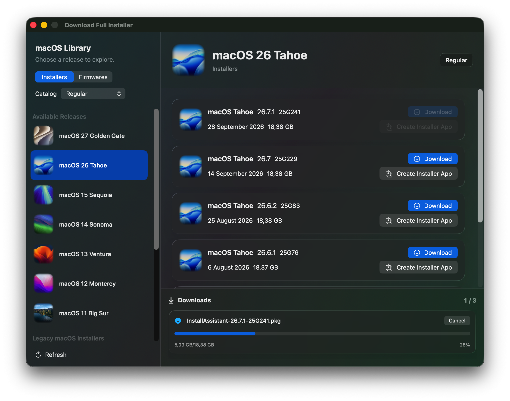
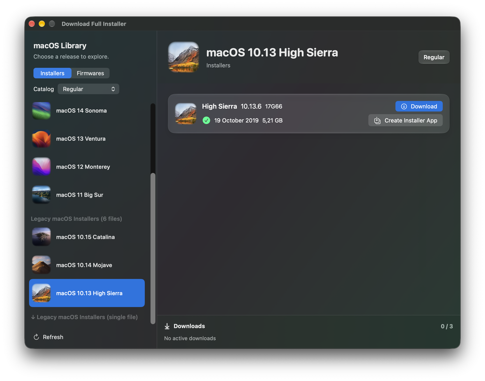

# Download Full Installer

**Download Full Installer** is a macOS application written in SwiftUI that downloads PKG installers or IPSW firmwares for the **Install macOS Big Sur** application and newer. Runs on macOS 14 Sonoma and later.

It also discovers:

- Multipart pre-Big Sur Intel installers, including High Sierra, Mojave, and Catalina, when Apple includes all six components in the selected software update catalog. Download the grouped components and use **Create Installer App** to assemble the installer app.  Do not open `InstallESDDmg.pkg` as a standalone installer
- Legacy macOS installers while Apple available direct links are available (Sierra, El Capitan, Yosemite, Mountain Lion, and Lion), the downloaded file is not a PKG installer but a DMG disk image containing the PKG installer.

See [legacy installer instructions](DOCS/Legacy-macos.md) for details about this legacy macOS.

**Versions**:

 - There is a version 2.5.5, built with Swift 5, that runs on macOS Big Sur or later, you can get the source code or the notarized app from the [releases page](https://github.com/perez987/DownloadFullInstaller/releases/tag/2.5.5).

### 🆕 New in version 6.0.0

The main window is now a wide, two-pane library with soft gradients and translucent surfaces. Choose Installers or Firmwares and a software update catalog on the left, then select a macOS release to see its available versions, build numbers, dates, sizes, and download actions on the right. The detail pane starts empty until you select a release.

Legacy installers appear at the end of the installer list. All downloads share the queue at the bottom right, with up to three simultaneous transfers, individual Cancel buttons, and Show in Finder actions. Changing the selected release or content type does not hide or interrupt downloads. Firmware comes from a separate feed, so the catalog picker is disabled in firmware mode.

|     |
|:---:|
|  |

### 🆕 New in version 6.1.0

Catalog-based multipart Intel installers are presented as one card per release. The app downloads all six required components into a product-specific folder, tracks the group as one item in the shared download queue, and limits component transfers to the existing three-download maximum. Once every component is present, choose **Create Installer App**. The app mounts `BaseSystem.dmg`, asks for access to its mounted Base System volume, and assembles the installer app alongside the components.

Multipart installers are currently available for High Sierra, Mojave, and Catalina when Apple's selected catalog includes them. They are Intel installers; creating the app does not make them compatible with Apple Silicon. Availability is controlled by Apple.

|     |
|:---:|
|  |

### Preface

As of June 2025, [DownloadFullInstaller](https://github.com/scriptingosx/DownloadFullInstaller) stopped its development. For over three years, my repository was a fork of the original. However, after the original was archived, I created a new repo as standalone (<em>not forked</em>) version.

This repo exists to keep "Download Full Installer" alive and growing. Picking up where the original left off, merging community PRs and adding new features. I'll keep this project active and up to date as long as it is useful to other users. Full credit for the original idea and architecture goes to <em>scriptingosx</em>.

### Features

- Target and requirements
   - Minimum macOS 14 Sonoma (up to macOS Golden Gate)
   - Swift 6
   - Xcode 26
- Main UI
   - Persistent release list and detail pane for installers and Apple Silicon IPSW firmware
   - Soft gradients, translucent cards, and matching Settings and Language sheets
- Preferences
   - Preferences for choosing catalog are no longer a separate dialog but are now at the top of the main window
   - All available releases are listed; select a release to view all its available downloads
- System sleep
   - Add sleep prevention logic to avoid sleeping while the application is running
- Downloads
   - Add download resume functionality that automatically handles network interruptions
   - Add progress bar overlaying to the application's dock tile icon during PKG downloads
   - Add support for up to 3 simultaneous downloads
   - Add customizable download folder selection
  - Clean up incomplete downloads on app quit
- Languages
  - Add language selection system
  - Update translations
- Legacy macOS
  - Download and assemble catalog-based multipart installers for High Sierra, Mojave, and Catalina when available
  - Download legacy macOS disk images; read [this](DOCS/Legacy-macos.md)
- Updater
  - Add Sparkle updater system (Swift Package Manager) to check for new releases
- Security
   - App is not sandboxed
   - App is notarized by Apple.

### Catalog-based multipart macOS installer download

Catalog-based High Sierra/Mojave/Catalina installers appear in the installer list when Apple's selected catalog provides all six components. Select a release and use its grouped **Download** action; components download into a product-specific subfolder, with up to three active transfers. When complete, choose **Create Installer App**. The app mounts `BaseSystem.dmg`; authorize its mounted Base System volume when prompted. It copies the installer app, populates `SharedSupport`, patches its metadata, and saves the result beside the components. Follow the [assembly instructions](DOCS/Legacy-macos.md#download-and-create-the-app). Opening `InstallESDDmg.pkg` directly fails even with all catalog files present. These are Intel installers and are not made compatible with Apple Silicon by assembly.

Legacy macOS disk-image downloads are listed separately under **Legacy macOS Installers** below current releases in the left-hand installer list. This section is collapsed on launch; use the chevron to expand it. Select a release to download its disk image using the shared download queue. Open the downloaded DMG in Finder and run its package to create the installer app. These downloads are independent of the selected software update catalog

### Create Installer App Feature

After downloading an `InstallAssistant.pkg` file, you can create the macOS installer application (e.g., "Install macOS Sonoma.app") directly from within Download Full Installer:

1. Download the PKG using the download button (↓)
2. Click the "Create Installer App" button next to the download button
3. The PKG file will open with the standard macOS installer
4. Follow the on-screen instructions to complete the installation
5. The macOS installer app will be created in the `/Applications` folder.

### Settings to select downloads folder

Download Full Installer -> Settings menu (⌘ ,) opens a window where you can select a different folder to download installers. Default is ~/Downloads. Visual indicators (green marks) of downloaded installers are updated to match those in the selected folder.

### Language selector window

Language selector can be opened from the menubar (`Languages` > `Select Language`) or by keyboard shortcut (`⌘ + L`).

### Incomplete downloads

The app is not sandboxed, so its temporary directory is the per-user system one (`/var/folders/.../T`), shared with other apps. The former cleanup on quit was removed because it could delete other apps' temporary files. Incomplete downloads left there are cleaned up by macOS.

<!--### App is damaged and can't be opened

If you see this message when you open Download Full Installer for the first time:
 `The application is damaged and cannot be opened.` 
Or this one:
 `Could not verify that Download Full Installer does not contain malicious software.` 
With the recommendation in both cases to move the file to the Trash, read this [document](DOCS/App-damaged.md). -->

# Original repository README
(by *scriptingosx*)

### Preface

This is a Swift UI implementation of the *scriptingosx*'s [fetch-installer-pkg](https://github.com/scriptingosx/fetch-installer-pkg) script. It will list the full macOS Big Sur (and later) installer pkgs available for download in Apple's software update catalogs. You can then choose to download one of them.

### Motivation

You may want to download the installer pkg instead of the installer application directly, because you want to re-deploy the installer application with a management system, such as Jamf. 

Since the Big Sur macOS installer application contains a single file larger than 8GB, normal packaging tools will fail. I have described the problem and some solutions in detail in [this blog post](https://scriptingosx.com/2020/11/deploying-the-big-sur-installer-application/).

### Extras

- Copy the download URL for a given installer pkg from the context menu.
- Change the seed program in the Preferences dropdown menu.
- Create the installer app directly from the downloaded PKG without leaving the application.

### Questions

#### Can this download older versions of the macOS installer application?

Yes. This fork supports fixed Apple disk-image links for Lion through Sierra (excluding Mavericks), plus multipart installers such as High Sierra, Mojave and Catalina when present in Apple's catalogs. Big Sur and later still use a single `InstallAssistant.pkg`. Apple can remove catalog entries at any time.

#### Will you update this so it can download older versions?

Support for catalog-based multipart installers is included; availability depends on Apple.

#### How is this different from other command tools?

As far as I can tell, this downloads the same pkg as `softwareupdate --fetch-full-installer` and `installinstallmacOS.py`.

The difference is that the other tools then immediately perform the installation so that you get the installer application in the `/Applications` folder. This tool just downloads the pkg, so you can use it in your management system, archive the installer pkg, or manually run the installation.

### Credits

- Both [fetch-installer-pkg](https://github.com/scriptingosx/fetch-installer-pkg) and this application are based on [Greg Neagle's installinstallmacos.py](https://github.com/munki/macadmin-scripts/blob/main/installinstallmacos.py) script.
- Thanks to [matxpa](https://github.com/matxpa): fixes and improvements in version 2.0.
